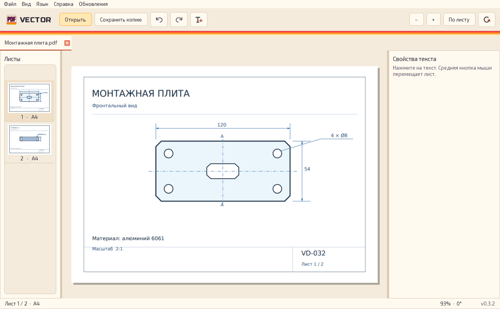
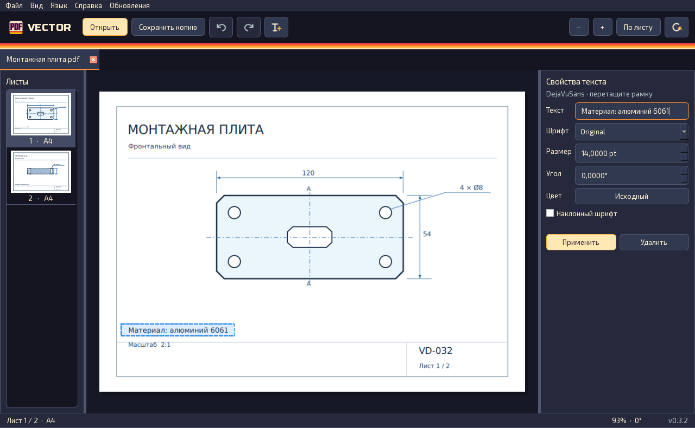

# Vector 0.3.2

Нативный редактор инженерных PDF для Windows 11 x64 и Linux. Открывает PDF в
нескольких вкладках и меняет поддерживаемый текст, сохраняя результат в
отдельную векторную копию. Исходный PDF никогда не перезаписывается.

В версии 0.3.2 выбор текста доступен сразу после открытия PDF. В Windows включена автоматическая загрузка подписанных обновлений. Подробности в [списке изменений](CHANGELOG.md).

[Релиз Vector 0.3.2 на GitHub](https://github.com/epigenezis-boop/epigenezis-boop-vector-pdf/releases/tag/v0.3.2) · [Скачать ZIP для Windows x64](https://github.com/epigenezis-boop/epigenezis-boop-vector-pdf/releases/download/v0.3.2/VECTOR-PDF-0.3.2-win-x64.zip)

## Интерфейс



Лист PDF в режиме подгонки по окну, слева миниатюры страниц.



Двойной щелчок выделяет строку и переводит фокус в поле «Текст».

## Запуск в Windows

Распакуйте архив `VECTOR-PDF-0.3.2-win-x64.zip` целиком и запустите
`VectorPDF.exe`. В комплекте CPython 3.12.10 и библиотеки; установка, права
администратора и отдельный Python не нужны.

Если вы пользуетесь версией 0.3.0, один раз распакуйте 0.3.2 в новую папку
и запускайте её. Версия 0.3.0 ещё не содержит рабочего ключа проверки подписи.
Если версия 0.3.1 сообщает об ошибке HTTPS при проверке обновлений,
тоже перейдите на 0.3.2 вручную.

При запуске Windows-версия проверяет обновления и загружает их автоматически,
если включён пункт «Загружать автоматически» в меню «Обновления» (по умолчанию
включён). Доступна и ручная проверка. Подписанный Ed25519 манифест и хэши
проверяются перед установкой. Обновление применяется при следующем запуске.
Если новая версия не подтверждает запуск, приложение выполняет откат.

Цифровая подпись Authenticode в этом окружении недоступна; локальная сборка
считается неподписанной. CI подписывает EXE только при наличии сертификата в
секретах.

## Первая правка

1. Откройте PDF через **Открыть** или перетащите в окно.
2. Приблизьте участок колесом. Перемещайте лист, удерживая среднюю кнопку мыши.
3. Щёлкните по строке, чтобы выделить её целиком, или дважды щёлкните для ввода.
4. Измените текст, размер, угол, наклон, цвет или шрифт. Перетаскивание рамки
   перемещает надпись. Нажмите **Применить**.
5. Нажмите **Сохранить копию** и укажите новое имя PDF. Если имя без `.pdf`,
   расширение **дописывается** (`report.docx` → `report.docx.pdf`), а
   существующая цель подтверждается отдельно.

Если исходный файл изменился на диске (OneDrive, сеть, другой редактор), правки
всё равно экспортируются из внутреннего снимка. Оригинал не изменяется.

## Безопасность редактирования

- Замена встроенным шрифтом разрешена только после проверки реального наличия
  глифов (simple cmap и Type0 CID→GID). Иначе используется безопасный
  встроенный fallback, а не пустой символ.
- Нативная замена допускается только для одного `Tj`-операнда. Строки,
  разбитые на несколько `Tj`, заменяются одним блоком на верхнем слое, поэтому
  абсолютные `Tm` больше не накладывают символы.
- Перемещённый/переформатированный текст получает явный цвет и размещается вне
  исходного clipping path. Текст внутри clipping помечается предупреждением.
- Текст в нестандартном цветовом пространстве, с `gs`, нестандартным render
  mode или небезопасной матрицей остаётся read-only с причиной.
- Подписи ищутся рекурсивно по достижимому графу, включая direct/nested
  словари. Пустые поля подписи и пустой `/Perms` не блокируют правку.
- После записи PDF переоткрывается QPDF/pikepdf и PDFium; проверяются число
  страниц, геометрия, отсутствие подписей, извлечение нового текста и
  неизменность потоков нетронутых страниц. Для больших CAD-потоков глубокий
  QPDF-токенайз кешируется/ограничивается по бюджету, чтобы не блокировать
  сохранение на секунды; быстрые проверки выполняются всегда. Существующая
  цель сохраняется как `.bak`.
- Шифрованные PDF и PDF с настоящей подписью доступны только для просмотра и
  байтового сохранения копии без правок.

## Поддержка

| Объект | 0.3 |
| --- | --- |
| Изолированный `Tj` с явным `Tm`, один show-оператор | Редактируется (при проверенном шрифте) |
| Строка из нескольких `Tj`/`BT` | Редактируется как один безопасный блок; исходные операнды очищаются |
| Текст внутри прямоугольного/сложного clip | Редактируется с предупреждением; перемещённая копия на верхнем слое |
| `TJ`, `Td/TD/T*`, `'`/`"`, Form XObject, Type3, vertical text | Просмотр; read-only с причиной |
| Встроенный simple TrueType/Type0 Identity-H | Проверка глифов, нативная замена или fallback |
| Нестандартные CMap/битые шрифты | Страница не теряется; проблемный шрифт read-only/fallback |
| Подписи/шифрование | Просмотр; сохранение копии без правок |

Подробнее: `KNOWN_LIMITATIONS.md`.

## Запуск из исходников

Нужен Python 3.12 x64.

```powershell
py -3.12 -m venv .venv
.venv\Scripts\python.exe -m pip install -r requirements-test.txt
.venv\Scripts\python.exe -m vector_pdf
```

Linux:

```sh
python3.12 -m venv .venv
.venv/bin/python -m pip install -r requirements-test.txt
.venv/bin/python -m vector_pdf
```

Имя PDF можно передать аргументом. Тесты:

```powershell
$env:PYTHONPATH='.'
$env:QT_QPA_PLATFORM='offscreen'
.venv\Scripts\python.exe -m pytest -q
```

Для реального чертежа задайте `VECTOR_TEST_PDF` и `VECTOR_TEST_STAMP` по
инструкции в `TEST_RESULTS.md`. Пользовательские чертежи в репозиторий не
входят.

## Сборка Windows x64

Сборка воспроизводима по `requirements.txt` и `tools/package_windows.py`:

```powershell
python -m pip download --platform win_amd64 --implementation cp --python-version 3.12 --abi cp312 --only-binary=:all: -r requirements.txt -d wheels
curl.exe --fail --location --output python-embed.zip https://www.python.org/ftp/python/3.12.10/python-3.12.10-embed-amd64.zip
python tools/sbom.py --output release/sbom.json
python tools/package_windows.py python-embed.zip wheels VectorPDF.exe release/VECTOR-PDF-0.3.2-win-x64.zip --manifest release/manifest.json --sbom release/sbom.json
```

Лаунчер собирается из `tools/launcher_windows.c` с `/GS`, PE-манифестом и
version resource (см. `.github/workflows/windows-tests.yml`). Готовый
`VectorPDF.exe` передаётся в `package_windows.py`. Подпись манифеста:

```powershell
python tools/update_keygen.py --private-key $env:USERPROFILE\vector-update.key
python tools/sign_manifest.py release/manifest.json --key $env:USERPROFILE\vector-update.key
```

Приватный ключ не входит в репозиторий и не должен попадать в архив.

[Архитектура](ARCHITECTURE.md) · [Замеры](BENCHMARKS.md) · [Ограничения](KNOWN_LIMITATIONS.md) · [Лицензии](THIRD_PARTY.md) · [Аудит](AUDIT_MATRIX.md) · [QA](QA_REPORT.md)
